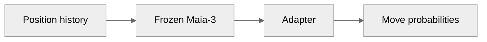
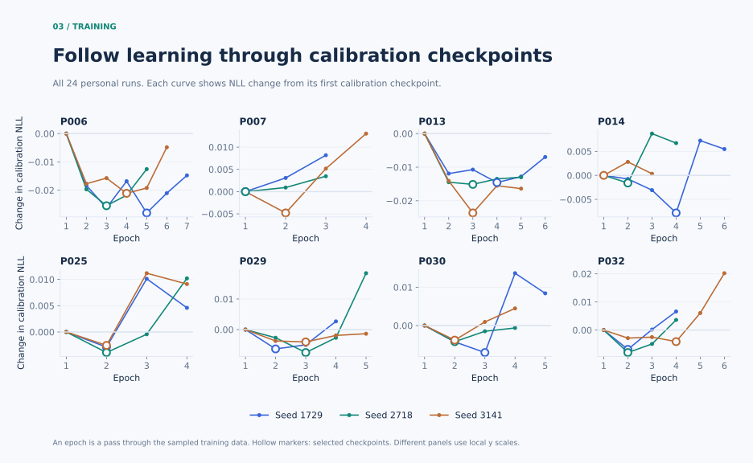
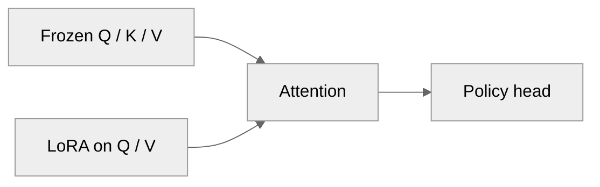
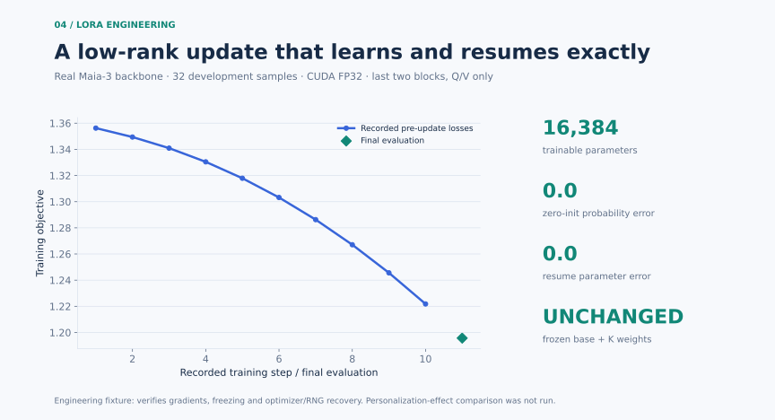
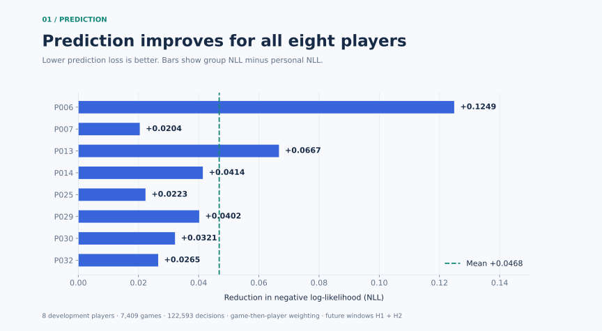
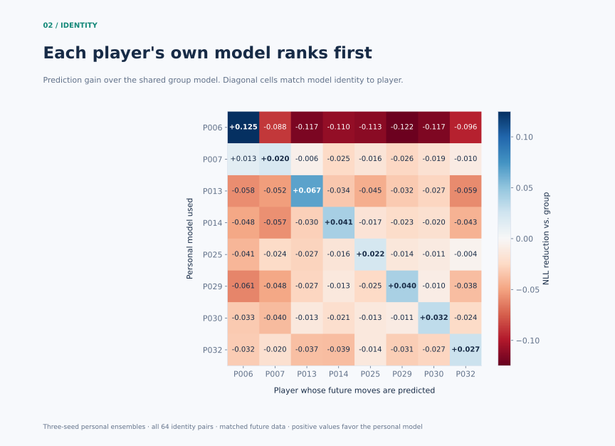
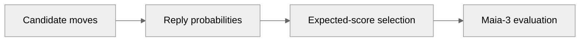
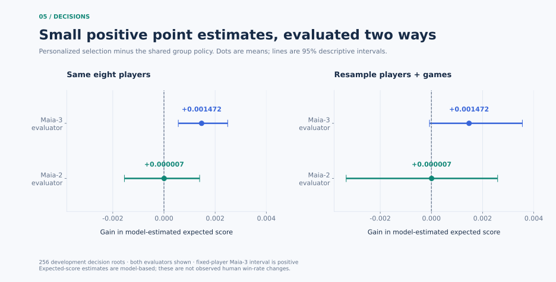

# Nemesis

Personalized chess-move prediction with PyTorch, residual adapters and Q/V LoRA.

Nemesis studies whether learning an individual player's habits improves future-move prediction, and how those predictions translate into move selection.

[中文导览](docs/RESEARCH_ZH.md) · [Implementation](docs/ENGINEERING.md) · [Results](docs/RESULTS.md)

## Model

**Maia-3** is a pretrained neural network that predicts human chess moves. Nemesis freezes its existing weights and trains a small **residual adapter**: an added neural layer that adjusts the network's features. The adapter has **17,936 trainable parameters**.



Training uses PyTorch **autograd** to compute gradients and **AdamW** to update the adapter. The loss rewards probability assigned to the actual human move, with a penalty for drifting from the original model. Only legal moves receive probability.

An effective batch of 256 is accumulated through 64-example **microbatches**, smaller groups processed separately to control GPU memory. Whole games are resampled, and each personal model is trained with three fixed **seeds**, which control the random choices in a run.

A separate **calibration split** selects the checkpoint and probability-mixing settings. **NLL**, or negative log-likelihood, measures how much probability the model gives the observed move; lower is better.

<details>
<summary>Calibration histories · 24 personal runs</summary>



Curves show the change from each run's first calibration NLL. Hollow markers identify the lowest observed value. An epoch is a pass through the sampled training data; panels use local vertical scales.

</details>

[Adapter and loss](src/nemesis/models/adapters.py) · [Training loop and recovery](src/nemesis/models/train.py) · [Calibration](src/nemesis/models/calibrate.py)

### Q/V LoRA

**LoRA** represents a weight update as the product of two small matrices. Nemesis implements rank-4 updates in the last two attention blocks, adding **16,384 trainable parameters** while keeping the original network frozen.

The updates target **Q** (query: what information attention looks for) and **V** (value: what information attention passes along). **K** (key: how information is matched) stays unchanged.



A **policy head** converts network features into move scores. PyTorch `parametrize` supplies the same effective packed attention weights during training and evaluation.



In a 32-sample CUDA FP32 engineering check, training loss falls from **1.356 to 1.196**. Checks also confirm unchanged initial predictions, frozen base weights and exact recovery of parameters, optimizer and random-number state after interruption. This engineering check is separate from the Adapter prediction results below.

[Q/V LoRA implementation](src/nemesis/models/lora_qv.py) · [Component tests](tests/unit/test_qv_lora.py)

## Prediction

The **group model** learns from all 32 players' permitted training data. Each **personal model** learns one player's data independently from the same original Maia-3 backbone. Both are evaluated on the same later games.



Personal models improve prediction for **all eight development players**, with mean NLL reduction **0.0468** across **7,409 games and 122,593 decisions**. Scores are averaged within games, then within players, then equally across players.

To check whether the model learned a particular person's habits, every personal model predicts every player's future moves.



Rows are personal models; columns are target players. Color shows NLL reduction relative to the group model, centered at zero. The diagonal matches each player to their own model.

Each player's own model ranks **first among all eight personal models**, with mean NLL advantage **0.0845** over the other seven. Personal predictions average three training seeds.

## Turn predictions into decisions

**Stockfish**, a chess search engine, screens candidate moves for objective quality. The personal model predicts possible opponent replies. Their probabilities weight the possible outcome values to produce an **expected score**.



Selections are saved before scoring. The Maia-3 evaluator is trained on separate games from the models that select moves.



Maia-3 estimates a mean gain of **+0.001472** over the group strategy on 256 development positions. Dots show the mean; lines show **95% descriptive intervals**, calculated by repeatedly resampling the observed data.

The fixed-player interval is **+0.000560 to +0.002491**. The second row also resamples player identities; its interval crosses zero. These values measure model-estimated expected score.

[Full decision comparison and definitions](docs/RESULTS.md#decision-comparison)

## Implementation

| Area | Source |
|---|---|
| PyTorch training, gradient accumulation and checkpoint recovery | [train.py](src/nemesis/models/train.py) |
| Residual adapters and training objective | [adapters.py](src/nemesis/models/adapters.py) |
| Packed Q/V LoRA and frozen-weight checks | [lora_qv.py](src/nemesis/models/lora_qv.py) |
| Probability calibration | [calibrate.py](src/nemesis/models/calibrate.py) |
| GPU execution, data pipeline and experiment design | [Engineering walkthrough](docs/ENGINEERING.md) |

## Reproduce

Python 3.12. Regenerate the figures from committed anonymous aggregates:

```bash
python -m pip install numpy matplotlib
python scripts/verify_showcase.py
python scripts/make_figures.py
```

Run the PyTorch component tests on CPU:

```bash
python -m pip install torch==2.8.0 --index-url https://download.pytorch.org/whl/cpu
python -m pip install -e ".[report,test]"
python -m pytest -q
```

The repository contains the research implementation, selected component tests, aggregate evidence and chart generators. Historical training uses separately provisioned source locks, pretrained weights and private game data. [Provenance and result definitions](docs/RESULTS.md) connect the figures to the research artifacts.

## References

Built on [Maia-3](https://github.com/CSSLab/maia3), [Maia-2](https://github.com/CSSLab/maia2), [Stockfish](https://stockfishchess.org/) and [Lichess](https://lichess.org/). Upstream code, weights, raw games and player identities are not redistributed; each upstream project retains its licensing terms.
