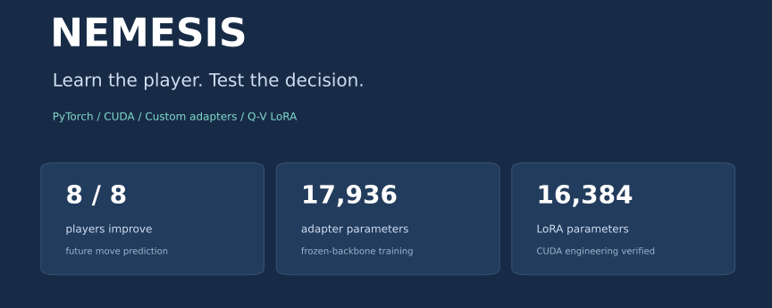
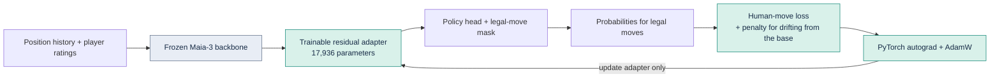
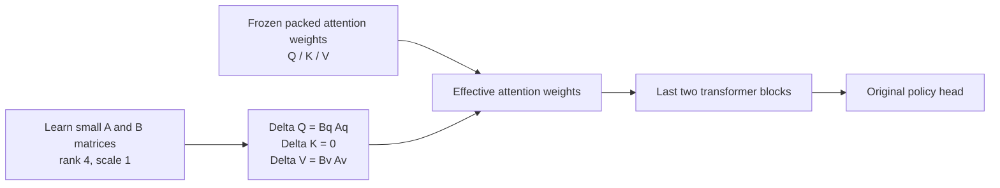
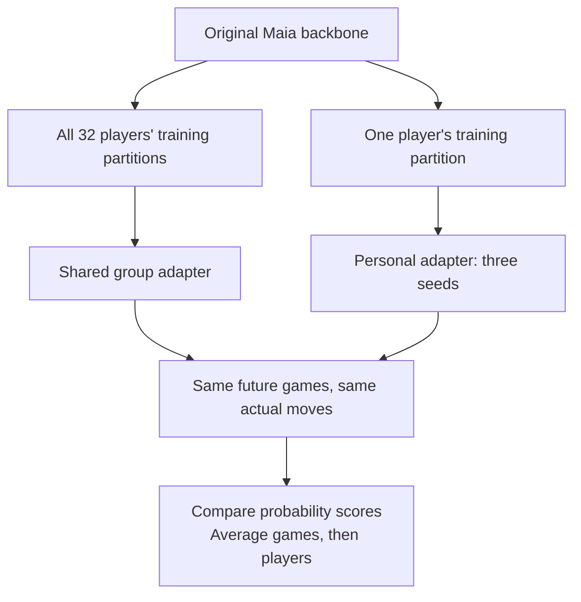
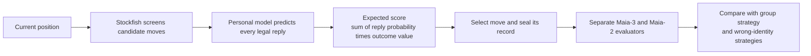

<p align="center"></p>

# Nemesis

**Personalized human-move prediction with PyTorch — from custom neural adapters to independently evaluated decisions.**

Can learning how a particular person plays chess help choose a better move against them? Nemesis connects a trained opponent model to a decision pipeline, then checks prediction and decision quality separately.

**[中文研究导览](docs/RESEARCH_ZH.md) · [Engineering walkthrough](docs/ENGINEERING.md) · [Results & reproduction](docs/RESULTS.md)**

## In 30 seconds

| Build | Measured result |
|---|---|
| **Train custom residual adapters** on a frozen Maia-3 backbone using PyTorch/CUDA | **8/8 development players** improve future-move prediction; mean NLL reduction **0.0468** against a trained group model |
| **Test personal identity**, not just average prediction | Each player's own three-seed model ranks **1st of 8** on that player's future moves |
| **Implement packed Q/V LoRA** in the last two transformer blocks | **16,384** trainable parameters; real CUDA gradient, freezing and exact-resume checks |
| **Connect probabilities to decisions** and score with separate evaluator models | Small positive mean gains: **+0.001472** with Maia-3 and **+0.000007** with Maia-2, in model-estimated score units |

The prediction findings use eight development players and future game windows. LoRA results are engineering validation; decision results are model-based estimates with intervals shown below.

## 1. Build and train the model

**Maia** is a pretrained neural network that predicts human chess moves. A **frozen backbone** keeps its existing parameters unchanged. A small **adapter** learns a player's habits on top of that representation.



The **policy head** turns network features into move scores. The **legal-move mask** removes moves forbidden by chess rules. **Autograd** computes gradients; **AdamW** uses them to update the trainable parameters.

The training system includes whole-game resampling, three fixed seeds per personal model, an effective batch of 256 through 64-example microbatches, calibration-based checkpoint selection, finite-gradient checks, and optimizer/RNG recovery. **RNG state** records the random-number generator so an interrupted run can resume consistently.

**Read the implementation:** [Adapter and loss](src/nemesis/models/adapters.py) · [Training loop, caches and resume](src/nemesis/models/train.py) · [Calibration](src/nemesis/models/calibrate.py)


**Calibration** is a separate data split used to select checkpoints and probability settings. Each hollow marker is the lowest observed calibration loss for that run. **NLL**, or negative log-likelihood, penalizes low probability assigned to the human's actual move; lower is better.

### A second implementation: Q/V LoRA

**LoRA** adds a trainable low-rank update to an existing weight matrix. Two small matrices produce the update, keeping the original weights frozen. Here it modifies **Q** (query: what information attention looks for) and **V** (value: what information attention passes along), while leaving **K** (key: how information is matched) unchanged.



The implementation uses PyTorch `parametrize` so both gradient-enabled training and evaluation read the same effective packed weight. Zero-initialized B matrices preserve the original policy at installation.


**Read the implementation:** [Packed Q/V LoRA](src/nemesis/models/lora_qv.py) · [Component tests](tests/unit/test_qv_lora.py). The chart is a 32-sample engineering fixture, separate from the completed Adapter personalization experiment.

## 2. Measure what the model learned

The **group model** was adapted using the permitted training data of all 32 players, with balanced game/player weights. Each **personal model** was independently adapted to one player from the same original backbone. Both predict the same later moves.




**All eight personal models improve on the group model**, with an average NLL reduction of **0.0468** across **122,593 decisions in 7,409 games**. NLL reduction is a probability-scoring improvement, not an accuracy percentage.

Does identity actually matter? Test every personal model on every player. In the prediction matrix below, **each player's own model ranks first among all eight personal models**. Its mean NLL advantage over the other seven models is **0.0845**.


The diagonal pairs each player with their own model. Every column uses the same future games. All identities are retained; color is centered at zero. The personal predictions average three training seeds, meaning three runs with different controlled random choices.

## 3. Turn predictions into decisions

**Stockfish**, a chess search engine, screens candidate moves for objective quality. The personal model predicts possible opponent replies. Each candidate is scored by weighting its possible outcomes by those reply probabilities.



**Expected score** is a probability-weighted average outcome value. **Sealing** saves a fixed, hash-bound selection before independent scoring. The evaluator models use separate training games from the selector models.


Both evaluator families produce positive mean estimates. **For the fixed eight-player cohort, the Maia-3 95% descriptive interval is entirely positive: +0.000560 to +0.002491.** The paired panel also resamples players as well as games; its intervals cross zero, as does Maia-2's gain interval. These are small gains in model-estimated expected score, not measured human win-rate changes.

A **descriptive interval** summarizes how the result changes when the existing observations are repeatedly resampled. Displaying both versions separates evidence about these eight players from sensitivity to which players are included.

## Engineering you can inspect

| Capability | Concrete implementation |
|---|---|
| PyTorch training | Frozen backbone, custom loss, legal masks, gradient accumulation, AdamW, early stopping |
| Parameter-efficient adaptation | Residual Adapter and packed Q/V LoRA, with declared trainable parameter sets |
| GPU execution | CUDA FP32 training/inference, batched prediction, device parity checks |
| Reliable experiments | Whole-game resampling, separate calibration, independent evaluators, seeded runs |
| Scientific Python | NumPy, memory-mapped caches, Parquet data, weighted statistics, Matplotlib figures |
| Recovery and provenance | Checkpoint metadata, optimizer/RNG restoration, source hashes, evidence manifests |

**[Browse the engineering walkthrough →](docs/ENGINEERING.md)**

## Reproduce the presentation

Python 3.12. Regenerate every chart from the committed anonymous aggregate data, without downloading model weights:

```bash
python -m pip install numpy matplotlib
python scripts/verify_showcase.py
python scripts/make_figures.py
```

Run the copied PyTorch component tests on CPU:

```bash
python -m pip install torch==2.8.0 --index-url https://download.pytorch.org/whl/cpu
python -m pip install -e ".[report,test]"
python -m pytest -q
```

This repository packages the research implementation, selected component tests, aggregate evidence and chart generators. Full historical training uses separately provisioned source locks, pretrained weights and private game data. [Source provenance and exact result definitions](docs/RESULTS.md) explain how the public figures connect to the research run.

## Credits

Built on the official [Maia-3](https://github.com/CSSLab/maia3), [Maia-2](https://github.com/CSSLab/maia2), [Stockfish](https://stockfishchess.org/) and [Lichess](https://lichess.org/) ecosystems. Upstream source, model weights, raw games and player identities are not redistributed in this repository. Each upstream project retains its own licensing terms.
