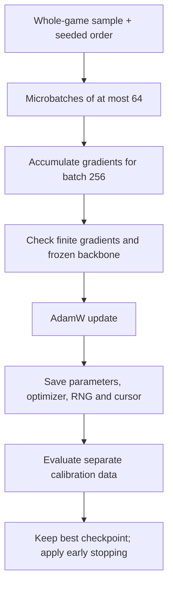

# Engineering walkthrough

[Back to project](../README.md) · [Results](RESULTS.md) · [中文](RESEARCH_ZH.md)

## Code reading map

| Question | Start here | What to inspect |
|---|---|---|
| How is a player-specific module built? | [adapters.py](../src/nemesis/models/adapters.py) | `ResidualAdapter`, `FrozenPolicy`, legal probabilities, supervised loss |
| How does training work? | [train.py](../src/nemesis/models/train.py) | `fit_cached`, calibration selection, whole-game bootstrap, weighted batches, resume state |
| How are attention weights adapted? | [lora_qv.py](../src/nemesis/models/lora_qv.py) | `PackedQV`, `QVPolicy`, PyTorch weight parametrization |
| How are probabilities calibrated? | [calibrate.py](../src/nemesis/models/calibrate.py) | Temperature grid, individual/group mixture, three-seed average |
| How are saved models used? | [personal_predictor.py](../src/nemesis/models/personal_predictor.py) | Model registry, role checks, checkpoint and policy hashes |
| How is a move selected? | [select.py](../src/nemesis/v2/select.py) | Probability-weighted reply values, uncertainty penalty, selection trace |
| How is it scored independently? | [evaluate.py](../src/nemesis/v2/evaluate.py) | Sealed selections and separate evaluator process |
| How are intervals calculated? | [statistics.py](../src/nemesis/v2/statistics.py) | Game-level resampling, paired identity multiplicities, two interval scopes |

## Residual Adapter

```text
h -> LayerNorm -> Linear(512,16) -> GELU -> Linear(16,512) -> add h
```

`h` is the backbone's hidden representation. **LayerNorm** rescales its features. **GELU** is a smooth nonlinear transformation. The two linear layers compress and expand the representation. Adding `h` creates a **residual connection**, preserving the starting representation while learning a correction.

The expansion layer starts at zero, so the installed adapter initially acts as the identity function. The 17,936 trainable parameters include normalization parameters and linear-layer biases. The pretrained backbone remains frozen and in evaluation mode, making dropout inactive while adapter gradients are computed.

## Training objective and state

The loss combines the negative log-probability of the observed human move with `0.1 * KL(personal || base)`. **KL divergence** measures how far the learned probability distribution moves from the original base distribution. Illegal moves are masked before normalization, and masked entries are handled explicitly to avoid invalid arithmetic.

Whole-game bootstrap draws entire games with replacement, keeping their retained decisions together. Game/player weights keep a long game or prolific player from dominating the objective. The effective batch of 256 is formed through microbatches of at most 64. Checkpoint selection uses a separate calibration split, with patience two: stop after two consecutive checks without improvement.



**A checkpoint** is a saved model/training state. The **cursor** records the point reached in the sample order. Restoration includes optimizer state and random state, not just the neural weights.

## Packed Q/V LoRA

The original attention projection packs Q, K and V into a single `1536 x 512` weight tensor. `PackedQV` constructs updates for Q and V, inserts an exactly zero K update, and adds the concatenated result to the original tensor. Each of the last two blocks receives four rank-4 tensors: `aq`, `bq`, `av`, `bv`.

`torch.nn.utils.parametrize.register_parametrization` installs the effective weight before optimizer construction. The declared total is 16,384 trainable parameters. Base attention weights, K, the original policy head and the upstream GAB component remain frozen. GAB is an upstream attention component, retained unchanged by this adaptation.

| Real-model CUDA check | Recorded outcome |
|---|---:|
| Zero-initialized policy vs. original | Maximum probability error 0 |
| Gradient-enabled vs. evaluation forward | Maximum probability error 0 |
| Cached frozen-prefix vs. full forward | Maximum probability error 0 |
| Original frozen parameters | Same hash before and after |
| B gradient, then A gradient after B updates | Nonzero |
| Interrupted/resumed parameters | Maximum error 0 |
| Optimizer, RNG and step restoration | Verified |

The 32-sample engineering fixture's objective decreased from 1.35625 to 1.19571. Its complete public summary is in [results.json](../evidence/results.json). This validates the implementation; a full Adapter-versus-LoRA effect comparison was not run.

## Probability calibration

**Temperature** changes how concentrated the probabilities are. The fixed candidates were 0.75, 1.0 and 1.25; calibration selected 1.0. **Alpha** is the personal-model weight in `alpha * personal + (1-alpha) * group`, chosen using that player's calibration data. Alpha zero remains valid and does not remove a player from evaluation.

## Executable scope

The public test suite exercises the adapter, LoRA weight update, checkpoint metadata and calibration contracts using small CPU tensors. Historical real-model CUDA evidence is recorded separately. Research-stage entry points remain in `src/` for code inspection and require their original provisioned assets/configuration; the public quickstart executes the component tests and figure pipeline.

Original first-party source and selected tests are copied byte-for-byte from the research checkpoint. [provenance.json](../evidence/provenance.json) records every copied file's SHA256, a fingerprint of its bytes.
