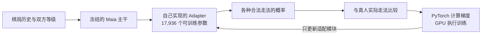
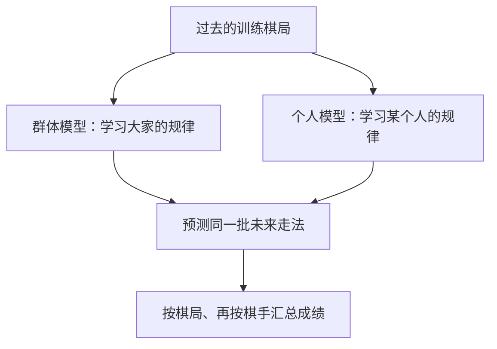
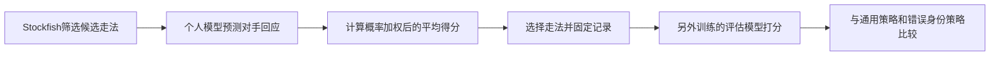

# Nemesis：从训练个人模型，到检验决策价值

[英文首页](../README.md) · [代码导览](ENGINEERING.md) · [数据与重绘方法](RESULTS.md)

**研究问题：了解某个人的走棋习惯，能不能帮助我们选择更适合对付他的走法？**

这个仓库按三个问题展示：怎么训练、学到了什么、怎样检验价值。

## 1. 怎么训练？

**Maia** 是已从真人棋谱学习过的神经网络。**主干**是它已有的主要计算部分；**冻结**表示训练时不改变这些参数。我们增加一个 **Adapter（适配模块）**，专门学习个人习惯。

**PyTorch** 是构建和训练神经网络的工具。**梯度**指出参数往哪个方向调整能降低错误。**GPU** 是适合大量并行计算的处理器。训练还包括防止模型偏离原有知识太远的约束，以及保存、加载、中断恢复检查。

项目为八位开发棋手各训练三个版本，共24个个人预测模型。**随机种子**控制训练中的随机选择，让不同版本能够重复运行。**校准集**是一组单独的数据，用来选择模型和调整概率；不使用未来评估数据来选参数。

图中的 **NLL（负对数似然）**衡量模型给真人实际走法的概率是否合理，越低越好。圆环标出每条训练记录中选中的最佳模型。**Epoch** 表示遍历一遍抽样后的训练数据。

另一个实现是 **LoRA（低秩适配）**：用较小的矩阵给原来的大权重增加调整。项目在最后两层注意力的 Q、V 上实现了16,384个可训练参数。**Q** 决定寻找什么信息，**V** 决定传递什么内容。

这项32样本验证证明了梯度、冻结、保存恢复和训练链路正确；它与已完成的 Adapter 个人化效果实验分开记录。

## 2. 学到了什么？

**群体模型**用32位棋手允许使用的训练数据学习整体规律。**个人模型**学习某一人的规律。两者都从同一个原始模型出发，比较时预测同一批后续真实走法。

**八位棋手全部改善，平均 NLL 降低0.0468。** 评价覆盖7,409盘棋、122,593次决策。这个数字是预测损失的差值，不是准确率提高4.68%。

把每个人的模型都拿来预测每个人，得到8×8矩阵。**每位棋手自己的模型都在八个模型中排名第一**，相对其他七人的平均 NLL 优势约为0.0845。

行表示使用谁的模型，列表示预测谁。对角线是“用自己的模型预测自己”。这提供了模型确实捕捉到个人行为差异的证据。

## 3. 怎样检验实际价值？

**Stockfish** 是用于搜索和评估棋局的强棋类引擎，先筛选客观上可以接受的候选走法。个人模型再预测对手如何回应，计算 **期望得分**：按每种回应的概率，对后续局面价值加权求平均。

**独立评估**表示选步模型与打分模型使用分开的训练棋局。项目同时使用 Maia-3 和 Maia-2 两套评估模型。

两套评估的平均收益点估计均为正。固定这八位棋手时，Maia-3 的95%描述性区间为 **+0.000560至+0.002491**，支持这组人的小幅正收益信号。把棋手差异也纳入抽样后，区间跨过零；Maia-2的收益区间也跨过零。

**描述性区间**通过反复抽取已有样本并重算结果，显示结果对样本变化的敏感程度。这些是模型估计的得分变化，不是已经观测到的真人胜率变化。

## 面试时如何讲

“我用 PyTorch/CUDA 在预训练棋类网络上训练自定义适配器，验证个人模型对后续真人走法的预测改善；同时实现 Q/V LoRA，检查梯度、冻结和精确恢复。然后把概率预测接入选步系统，用独立评估模型和身份交叉对照检验决策收益。”

代码入口：[Adapter](../src/nemesis/models/adapters.py)、[训练循环](../src/nemesis/models/train.py)、[LoRA](../src/nemesis/models/lora_qv.py)、[校准](../src/nemesis/models/calibrate.py)、[选步](../src/nemesis/v2/select.py)。
