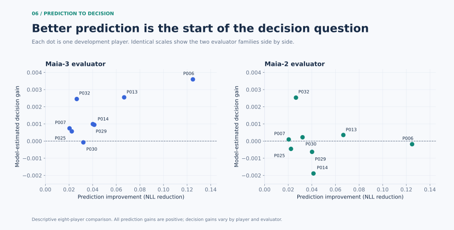

# Results, definitions and reproduction

[Back to project](../README.md) · [Engineering](ENGINEERING.md)

## Evidence map

Every displayed value is exported from an existing research artifact. [results.json](../evidence/results.json) contains the plotting data; [provenance.json](../evidence/provenance.json) lists source artifact paths and SHA256 fingerprints at research commit `88346089bd0c8363d0aea0ef073d482dee0c4637`.

| Display | Research evidence |
|---|---|
| Prediction improvement / identity matrix | `B03/validation/dev_prediction_matrix.json`, checked against `B03/dev_gate.json` |
| Calibration curves | `B03/training_summary.json`, all 24 personal T runs |
| LoRA engineering | `V2/B05A/qv_real_model_evidence.json` |
| Decision means and intervals | `V2/B04B/E3_PERSONAL_PLAIN_summary.json`, E2 counterpart and `bootstrap.json` |
| Prediction-to-decision scatter | `V2/B04B/prediction_to_decision.json` |

The entire prepared dataset contains 32 players, 146,156 games and 2,540,865 retained samples across partitions. This is a dataset inventory, not the number of independent observations or the training count of each personal model. Prediction evaluation here covers eight development players, 7,409 games and 122,593 retained decisions.

## Prediction comparison

**G0** is original Maia-3. **G** is a shared adapter trained using all 32 players' permitted Fit-A training partition. **T** is a three-seed personal ensemble; each component starts from the original base, then learns one player's Fit-A data. E3 and E2 are evaluators trained on the separate Fit-B game partition using Maia-3 and Maia-2 respectively. Future confirmation labels are not used in these figures.

For each game, average the decision-level metric. For each player, average their games. Finally, average players with equal weights. H1 and H2 are the two future time windows; their aggregate summaries are combined with game-count weighting.

The prediction heatmap cell at row i, column j is `NLL(group on j) - NLL(personal i on j)`. A positive cell favors the personal model. All eight diagonal models rank first in their respective columns. This is descriptive future prediction on the eight known development identities.

## Decision comparison

The main decision figure uses the original `PERSONAL_PLAIN` selector, with no disagreement penalty. A separate robust variant was explored during tuning; it does not replace the primary results shown here. The utility matrix uses a 256-root development panel: a **root** is a starting position from which candidate moves are compared.

**Gain G** is the correct-person strategy's modeled expected score minus the shared group strategy's score. **Specificity S** compares the correct-person strategy with the average of the other seven personal strategies. A good S can partly reflect harm from using the wrong identity, so G and S answer different questions.

| Endpoint | Maia-3 | Maia-2 |
|---|---:|---:|
| Mean gain G | +0.001471620 | +0.000007135 |
| Mean specificity S | +0.002337505 | +0.000612431 |
| Positive-G players | 7 of 8 | 4 of 8 |
| Fixed-player 95% G interval | [+0.000560287, +0.002490827] | [-0.001545383, +0.001393698] |
| Player-and-game 95% G interval | [-0.000073684, +0.003555067] | [-0.003329938, +0.002587995] |

Both interval calculations use 5,000 bootstrap replicates: repeat the sampling and scoring procedure 5,000 times. The fixed-player version resamples games while holding the eight identities fixed. The other version resamples both identities and games with paired source/target identity weights. The output contains 95% percentile intervals; no 90% intervals have been inferred from their endpoints.

The result supports a small positive Maia-3 development gain for the fixed eight-player cohort. Broader player resampling and Maia-2 provide the accompanying sensitivity views. These are model-estimated scores, not observed human match outcomes.



## Rebuild the figures

```bash
python -m pip install numpy matplotlib
python scripts/verify_showcase.py
python scripts/make_figures.py
```

The renderer loads only committed aggregates and writes seven figure pairs under `assets/`. PNGs support slide reuse; SVGs retain sharp text in the README. Matplotlib may produce small layout changes across platforms, but the exported metrics are fixed.

For the research owner, the allowlisted export can be rebuilt from the original checkout:

```bash
python scripts/export_results.py /path/to/nemesis-dev
```

This exports anonymous player-level aggregates, selected training histories and first-party code. It excludes raw games, account identities, model weights and per-position predictions. The historical source artifact hashes can be checked against the original research checkout; the public repository can independently verify its copied source hashes and internal aggregate arithmetic.
